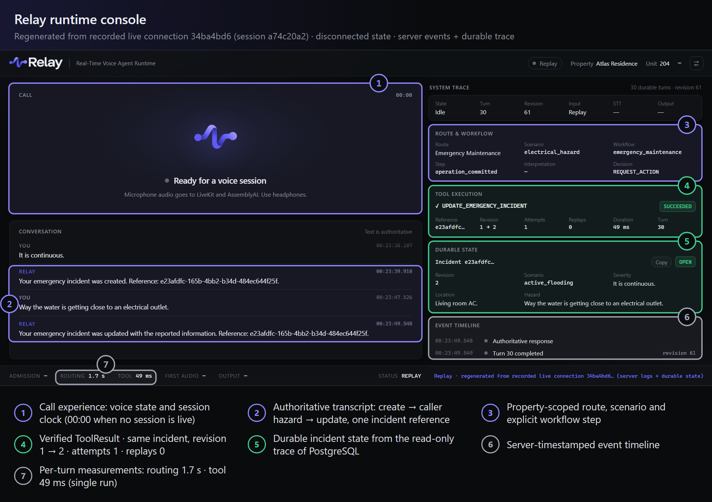
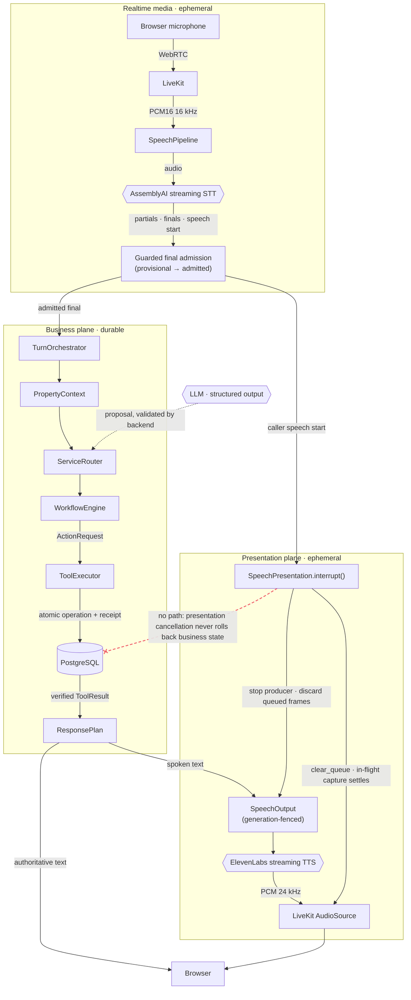
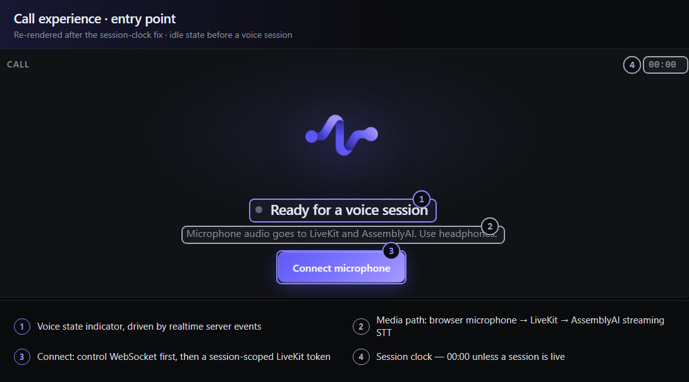
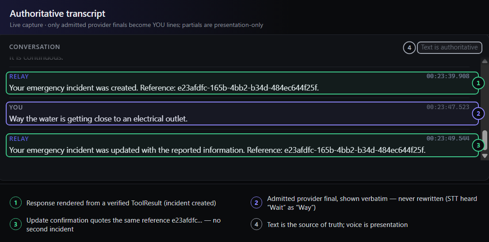
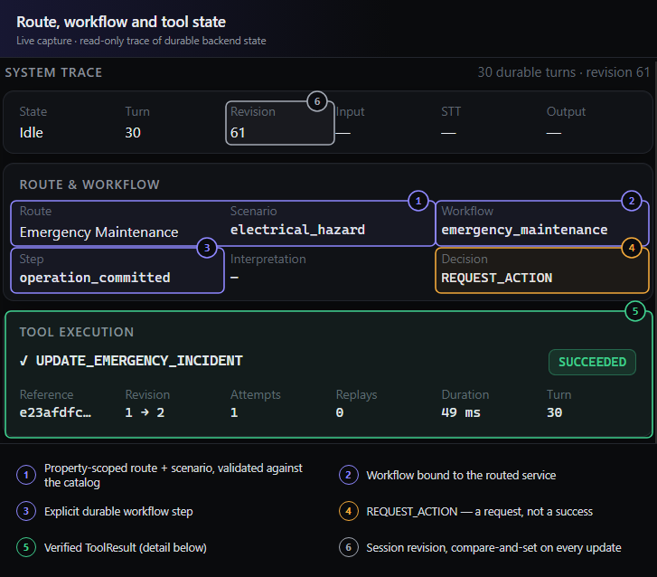
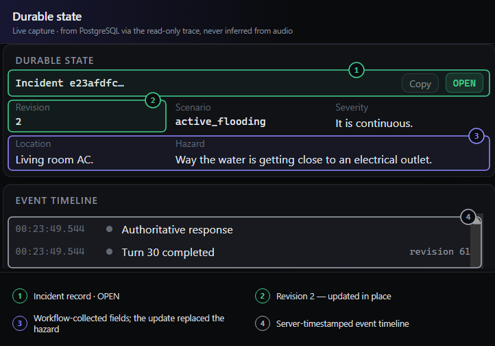
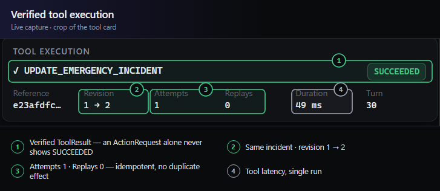
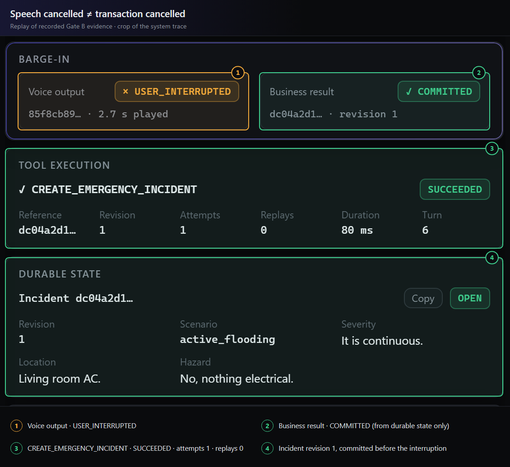
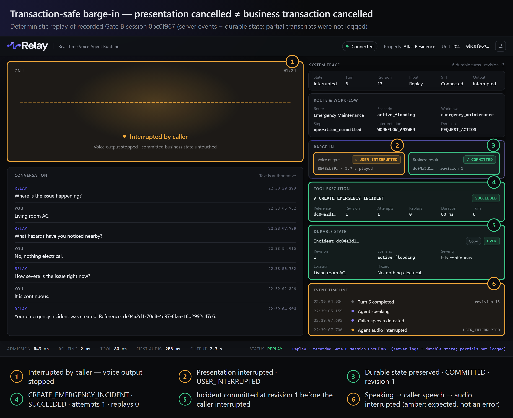
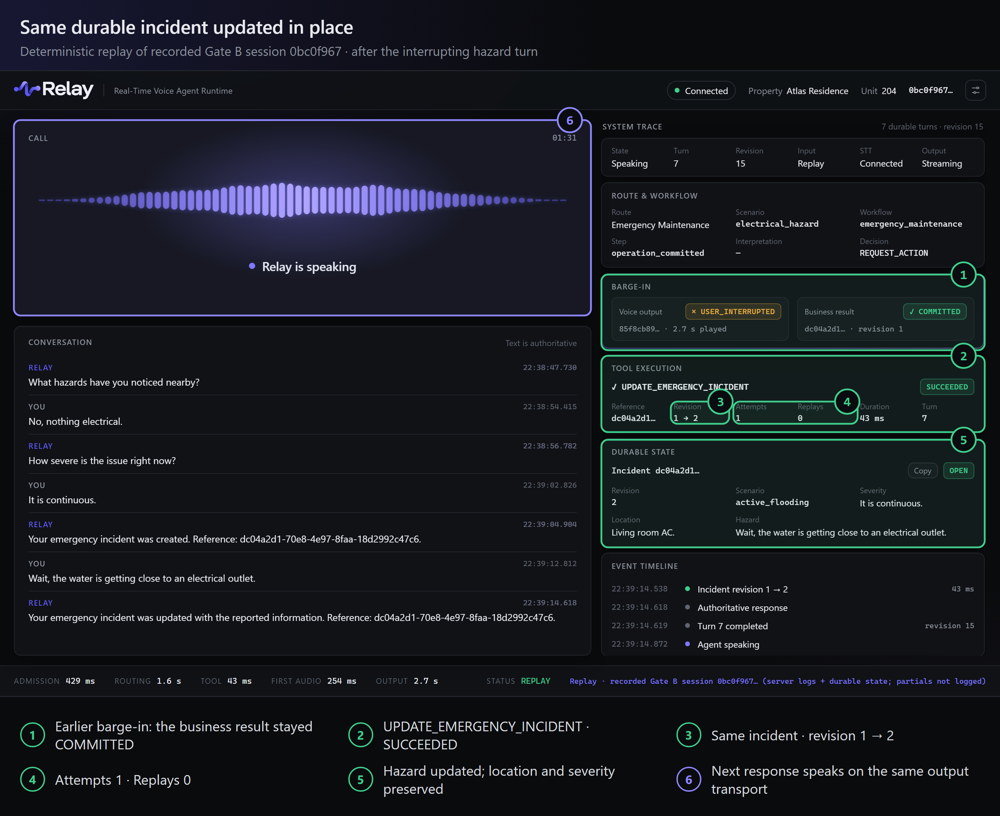

<h1 align="center">
  <br>
  Relay
</h1>

<p align="center">
  <strong>A realtime voice-agent runtime</strong> with streaming STT, guarded turn admission,
  property-scoped routing, durable workflows, idempotent transactional tools and
  transaction-safe barge-in.
</p>

<p align="center">
  <a href="https://github.com/ikramgafai/relay-property-voice-agent/actions/workflows/ci.yml"></a>
  <a href="https://github.com/ikramgafai/relay-property-voice-agent/releases/tag/v0.10.0"></a>
  
  
  <a href="LICENSE"></a>
</p>

> Models may propose decisions, but backend state and verified tool results remain authoritative.

## Runtime Console



<sub>Regenerated from a recorded live connection (server events + durable trace) after a
session-clock fix, so the disconnected console shows 00:00; the original live capture is
[05-original.png](docs/assets/relay-console/05-original.png).</sub>

The console is a window into the runtime, not a chat skin. The left side is the caller's
experience: realtime voice state, the waveform, and an authoritative transcript in which only
admitted provider finals become caller lines. The right side is a system inspector: the
property-scoped route and scenario, the explicit workflow step, the latest verified `ToolResult`
with attempts and replays, the durable incident record, and a server-timestamped event timeline.
The bottom strip shows per-turn measurements (admission, routing, tool, first audio, output).

**The UI never infers business success from audio.** Voice state comes from realtime lifecycle
events. Business facts (route, workflow step, tool outcome, incident revision) come only from
`GET /api/demo/sessions/{id}/trace`, a read-only, allowlisted projection of durable PostgreSQL
state: turn checkpoints, tool receipts, workflow runs and operation records. It cannot write, run
tools, or expose request payloads, idempotency keys, prompts or model reasoning. An
`ActionRequest` is shown as *requested* until a verified `ToolResult` exists.

Property management is the demonstration domain, not the product boundary.

## Why Relay exists

Voice agents that take actions fail in specific ways: a generated "your ticket is created" with no
record behind it, a retried tool call that creates a second incident, a pause mid-sentence that
splits one request into two, or a context-free fragment that quietly moves an emergency into a
routine queue. Relay is built around preventing those failures rather than demonstrating fluency.

The central idea: **realtime presentation state and durable business state are different
planes.** Speech can be streamed, interrupted, cancelled or lost; a committed incident cannot be
rolled back by any of that.

## Architecture



| Component | Role | Cannot |
| --- | --- | --- |
| LiveKit | Transports caller and agent audio | Decide turns, identity or property |
| AssemblyAI | Transcribes and proposes turn boundaries | Create an application turn by itself |
| Guarded admission | Decides when a provider final becomes a turn | Route, run workflows or call tools |
| ServiceRouter | Selects an enabled service for this property | Execute anything |
| WorkflowEngine | Decides what happens next | Perform side effects |
| ToolExecutor | Owns trusted side effects, idempotency, verification | Act without an authorized ActionRequest |
| ToolResult | Establishes business truth | — |
| SpeechOutput / TTS | Presents trusted text as audio; stops when the caller interrupts | Change business state |

## What Happens During a Voice Turn

The screenshots below are live captures from one console session, except the step 1 entry-point
image (regenerated idle state after a session-clock fix; original:
[01-original.png](docs/assets/relay-console/01-original.png)) and step 5 (a labelled replay of
recorded Gate B evidence).

### 1. Voice input and guarded admission



```text
browser microphone → LiveKit → PCM16 → AssemblyAI streaming STT → provisional provider final
  → 400 ms admission grace (coalesce or fail closed) → one authoritative application turn
```

Partial transcripts are presentation-only and never reach business logic. A provider final stays
provisional for the admission grace: speech resuming inside it is coalesced into the same turn, and
an utterance that may be incomplete is aborted rather than admitted as a prefix. Only an admitted
final becomes a business turn, and its text is shown verbatim.



### 2. Property-scoped routing



```text
PropertyContext → enabled services → evidence-first routing
  → constrained model interpretation when needed → backend validation
```

The property's context is loaded before routing, so only that property's enabled services can be
selected. Configured evidence and workflow continuation come first; a model is consulted only when
the evidence is insufficient, and its proposal is validated against the catalog (invented or
foreign IDs are rejected; clarify or abstain beats a confident wrong route). **Routing selects the
service. It does not execute side effects.**

### 3. Durable workflow execution



```text
ServiceRouter → WorkflowEngine → explicit state machine → ActionRequest
```

Workflows are explicit, persisted state machines that collect fields (here location, severity and
hazard) and decide the next step. A pending answer cannot silently downgrade an unfinished
emergency. When ready, a workflow emits an `ActionRequest`, which is a declaration of intent:
**`ActionRequest` ≠ success.**

### 4. Verified tool execution



```text
ActionRequest → ToolExecutor → idempotency guard → DB transaction → operation + receipt
  → re-verified in a fresh transaction → ToolResult
```

The `ToolResult` is authoritative: `SUCCEEDED`, `FAILED` or `UNKNOWN_OUTCOME` (plus explicit
validation outcomes). A retry with the same action ID and canonical request hash replays the
recorded result instead of repeating the effect; changed arguments conflict. If a commit
acknowledgement is lost and verification is unavailable, the outcome is `UNKNOWN_OUTCOME` and is
reconciled, never blindly retried. Local atomicity is not distributed exactly-once.

### 5. Transaction-safe barge-in



```text
agent speaking → caller speech detected (≤ 1 request per provider turn) → presentation interrupted
  → queued audio discarded → native LiveKit queue cleared → in-flight capture allowed to settle
  → business state untouched → caller utterance becomes the next normal turn
```

`SpeechOutput` fences by generation, so an interrupt affects only outputs that already exist. An
in-flight `capture_frame()` is never intentionally cancelled: `clear_queue()` releases it, a second
clear drops the last frame, and the same sink speaks the next response. The voice output ends
`CANCELLED` / `USER_INTERRUPTED`; the incident created just before stays committed at revision 1,
and the interrupting hazard updates **that same incident** to revision 2.

## Transaction-Safe Barge-In



<sub>Deterministic replay of the recorded Gate B session (server events + durable state), rendered
in the console; it is not a live screen capture.</sub>

Validated with a real microphone (Gate B, [evidence](docs/verification/phase-10-verification.md)):

1. The caller reports active flooding.
2. The emergency workflow collects location, hazard and severity.
3. `CREATE_EMERGENCY_INCIDENT` succeeds (attempts 1, replays 0).
4. Incident revision 1 is committed — about 2.86 s before the interruption.
5. Relay starts speaking the confirmation.
6. The caller interrupts.
7. The voice output ends `USER_INTERRUPTED`, about 13 ms after the interrupt request.
8. Business state remains committed; nothing is cancelled or rolled back.
9. The new caller turn, admitted in full, reports an electrical hazard.
10. `UPDATE_EMERGENCY_INCIDENT` targets the same incident (attempts 1, replays 0).
11. The incident revision advances 1 → 2; location and severity are preserved.
12. The next response speaks normally on the same output transport.

<details>
<summary>After the update: same durable incident, revision 1 → 2 (Gate B replay)</summary>



</details>

## Engineering Invariants

| Invariant | Relay behavior |
| --- | --- |
| Model output is not business truth | The backend validates routing proposals against the property catalog and workflow transitions |
| An action request is not success | Only a verified `ToolResult` establishes an outcome and produces success text |
| Duplicate tool request | Stable action identity + canonical request hash: the recorded result is replayed, the effect is not repeated |
| Unknown commit acknowledgement | `UNKNOWN_OUTCOME`, reconciled from durable receipts; never blindly retried |
| STT partial | Presentation only; never becomes a turn |
| Provider final | Provisional until the admission grace admits it (or aborts it) |
| Barge-in | Cancels speech presentation, not durable work |
| Committed database state | Never rolled back because audio was interrupted |
| Realtime disconnect | Does not undo committed business state; replay recovers the saved result |
| Property context | Loaded before routing; another property's catalog is never used |
| Exact business replay | Returns the saved result and is never re-spoken |

## Verified results

| Scope | Evidence |
| --- | --- |
| **v0.10.0 release baseline** | 569 Compose tests (PostgreSQL 17 + LiveKit in Docker), strict mypy, Ruff; real-microphone Gate A and transactional Gate B passed |
| **Current main (portfolio console + read-only trace)** | 574 Compose tests, 24 browser tests, strict mypy and Ruff clean |
| **Phase 9 speech output** | 9-turn Atlas flagship: 9 provider finals → 9 admitted turns, 9/9 outputs completed, one incident created and updated in place, a linked handoff |

Measured in single live runs (not benchmarks): Relay took about 2–10 ms from the provider's raw
speech signal to the interrupt request, while AssemblyAI reported speech about 1.4–1.5 s after
onset; interrupt request to `USER_INTERRUPTED` took 9–17 ms; warm first TTS audio ≈ 240–253 ms.

Honest record: the first real-microphone barge-in attempt failed (late cutoff; the provider kept
only the last word of the interruption) and led to the speech-start instrumentation used for the
successful validation. Live coalescing of two provider finals into one turn has not been observed
(covered by deterministic tests). Full evidence: [Phase 10](docs/verification/phase-10-verification.md) ·
[Phase 9](docs/verification/phase-9-verification.md) · [all phases](docs/verification/README.md).

## Running locally

Requires Docker with Compose and [uv](https://docs.astral.sh/uv/) 0.12.24+.

```text
docker compose build backend
docker compose up -d --wait postgres
docker compose run --rm backend alembic upgrade head
docker compose run --rm backend relay-seed
docker compose up -d --wait backend
```

The backend serves `http://127.0.0.1:8000`. Text turns work with no external providers; voice needs a
LiveKit server and AssemblyAI (and ElevenLabs for speech output). See
[development](docs/development.md) for configuration and the browser voice console
(`frontend/voice.html`).

<details>
<summary>Tests</summary>

```text
docker compose -f compose.test.yml up --build --abort-on-container-exit --exit-code-from tests
docker compose -f compose.test.yml down
node --test frontend/tests/relay-audio.test.mjs frontend/tests/relay-state.test.mjs
```

The Compose suite runs real PostgreSQL and a real LiveKit server; providers are faked and live HTTP
is blocked. CI runs Ruff, formatting, strict mypy, the browser tests and the Compose suite.

</details>

<details>
<summary>Demo script</summary>

| Caller | Relay |
| --- | --- |
| "My AC isn't cooling properly." | Non-Emergency Maintenance; asks for symptoms |
| "My AC is only blowing warm air." | Natural answer to the workflow question; offers a request |
| "Actually, water is pouring out of it." | Escalates to Emergency Maintenance (active flooding) |
| "Living room AC." | The model can read this fragment as routine AC; the backend pins it as the answer to the emergency's location question |
| "No, nothing electrical." / "It is continuous." | Creates the emergency incident and starts speaking the confirmation (reference shown in text, not spoken) |
| *(interrupting)* "Wait, the water is getting close to an electrical outlet." | Stops speaking; the committed incident stays; updates the **same** incident |
| "I want to speak with someone." / "Yes, please." | Creates a human handoff linked to the incident; says no live transfer occurred |

</details>

## Tech stack

Python 3.12 · FastAPI · Pydantic v2 · SQLAlchemy 2 (async) · PostgreSQL 17 · Alembic · LiveKit ·
AssemblyAI streaming v3 · ElevenLabs HTTP streaming · OpenAI-compatible structured outputs (tested
with OpenRouter) · httpx · structlog · pytest · strict mypy · Ruff · uv · Docker Compose ·
GitHub Actions · dependency-free browser ES modules

## Roadmap and docs

- Optional faster interruption through local voice-activity detection (provider speech detection
  currently dominates barge-in latency).
- Input admission hardening (push-to-talk or voice-activity gating for open microphones).
- Latency and accuracy measurement; deployment hardening. Details in [roadmap](docs/roadmap.md).

[architecture](docs/architecture.md) · [speech](docs/speech.md) · [routing](docs/routing.md) ·
[orchestration](docs/orchestration.md) · [workflows](docs/workflows.md) · [tools](docs/tools.md) ·
[realtime](docs/realtime.md) · [contracts](docs/contracts.md) · [decisions](docs/decisions/) ·
[verification](docs/verification/README.md) · [release notes](docs/releases/v0.10.0.md)
