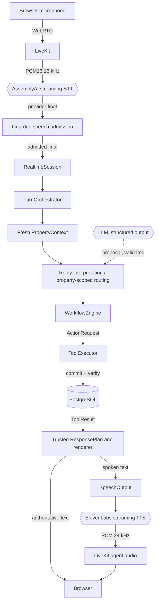

# Relay — Real-Time Voice Agent Infrastructure

Reliability-focused infrastructure for transactional voice agents: streaming speech, property-scoped
routing, durable workflows, guarded turn admission, idempotent tools, realtime audio output and
explicit failure semantics. Property management is the demonstration domain, not the product
boundary.

> Models may propose decisions, but backend state and verified tool results remain authoritative.

## What Relay is

A caller speaks; Relay transcribes, decides which property service applies, advances a durable
workflow, executes side effects through trusted tools, and answers in text and voice. Every success
it reports is backed by a committed, re-verified record in PostgreSQL.

## Why it exists

Voice agents that take actions fail in specific ways: a generated "your ticket is created" with no
record behind it, a retried tool call that creates a second incident, a pause mid-sentence that
splits one request into two, or a context-free fragment that quietly moves an emergency into a
routine queue. Relay is built around preventing those failures rather than demonstrating fluency.

## Architecture



| Component | Role | Cannot |
| --- | --- | --- |
| LiveKit | Transports caller and agent audio | Decide turns, identity or property |
| AssemblyAI | Transcribes and proposes turn boundaries | Create an application turn by itself |
| Guarded admission | Decides when a provider final becomes a turn | Route, run workflows or call tools |
| Routing | Selects an enabled service for this property | Execute anything |
| WorkflowEngine | Decides what happens next | Perform side effects |
| ToolExecutor | Owns trusted side effects, idempotency, verification | Act without an authorized ActionRequest |
| ToolResult | Establishes business truth | — |
| SpeechOutput / TTS | Presents trusted text as audio | Change business state |

## Reliability guarantees

- **Property context before routing**; only that property's enabled services can be selected.
- **Model output is validated by the backend**: invented or foreign IDs are rejected; clarify or
  abstain beats a confident wrong route.
- **Durable workflows** own state progression; a pending answer cannot silently downgrade an
  unfinished emergency.
- **ActionRequest is not success.** Only a committed, re-verified ToolResult produces success text.
- **Idempotent actions** (action ID + canonical request hash); unknown outcomes are reconciled,
  never blindly retried.
- **Business state is separate from realtime presentation state**: disconnects, TTS failures and
  cancellations never roll back committed work.
- **Partial transcripts never become turns**, and provider final boundaries are guarded before
  admission (fail closed when an utterance may be incomplete).
- **Replayed business turns are not re-spoken**; spoken text omits raw reference UUIDs.
- **Bounded output buffering** with backpressure into the TTS stream.

## Real-time voice pipeline

- **Input:** browser mic → LiveKit → AssemblyAI v3 streaming (`universal-3-6-pro`). Provider
  endpointing is 800 ms / 2000 ms; Relay then holds each provider final for a 400 ms admission
  grace, coalescing speech that resumes inside it and aborting (not admitting) utterances that may
  be incomplete.
- **Output:** trusted response → spoken-text filter → `SpeechOutput` (one active, one pending,
  500 ms buffer) → ElevenLabs `eleven_flash_v2_5` HTTP streaming (`pcm_24000`) → 20 ms frames →
  LiveKit `relay-agent-audio` track on the same backend participant → browser `<audio>`.
- **Order:** the text response and turn completion are always sent before any audio starts.

## Transactional tool semantics

Workflows declare `ActionRequest`s; `ToolExecutor` executes them. Each operation and its receipt
commit atomically, then are re-read in a fresh transaction before success is reported. A retry with
the same action ID and hash replays the recorded result; changed arguments conflict. If the commit
acknowledgment is lost and verification is unavailable, the result is `UNKNOWN_OUTCOME`, reported as
such. Local atomicity is not distributed exactly-once.

## Verified Phase 9 results

Measured on a real browser microphone, real AssemblyAI, real ElevenLabs and a local LiveKit server
([full evidence](docs/verification/phase-9-verification.md)):

- **9-turn Atlas flagship:** 9 provider finals → 9 admitted turns; 0 duplicate/stale finals,
  0 `SESSION_BUSY`, 0 provisional aborts.
- **Speech output:** 9/9 outputs `COMPLETED`; warm first TTS audio ≈ 240–253 ms; audibility
  confirmed by a human listener during validation.
- **Business invariants:** 1 incident created and the same incident updated once (revision 1 → 2),
  0 maintenance requests, 1 human handoff linked to the incident, 3 successful tool calls,
  0 duplicate executions, no Palm Heights leakage.
- **Regression fixed:** a sentence with a mid-sentence pause previously split into two turns and
  two incident updates; with the new endpointing and admission grace it became one turn and one
  update.
- **Suite:** 530 tests passing (PostgreSQL 17 + LiveKit in Docker), strict mypy clean, Ruff clean.

Not yet observed live: two provider finals coalescing into one turn (covered by deterministic
tests only). One brief output underrun occurred in the flagship; the output recovered and completed.

## Demo scenario

| Caller | Relay |
| --- | --- |
| "My AC isn't cooling properly." | Non-Emergency Maintenance; asks for symptoms |
| "My AC is only blowing warm air." | Natural answer to the workflow question; offers a request |
| "Actually, water is spouting out of it." | Escalates to Emergency Maintenance (active flooding) |
| "Living room AC." | The model reads this fragment as routine AC; the backend pins it as the answer to the emergency's location question |
| "No, nothing electrical." / "It is continuous." | Creates the emergency incident (reference shown in text, not spoken) |
| "Wait, the water is getting close through an electrical outlet." | Updates the **same** incident |
| "I want to speak with someone." / "Yes, please." | Creates a human handoff linked to the incident; says no live transfer occurred |

This exercises every boundary above: guarded admission, interpretation with workflow context,
safety-critical pinning, idempotent create/update and truthful presentation.

## Running locally

Requires Docker with Compose and [uv](https://docs.astral.sh/uv/) 0.12.24+.

```text
docker compose build backend
docker compose up -d --wait postgres
docker compose run --rm backend alembic upgrade head
docker compose run --rm backend relay-seed
docker compose up -d --wait backend
```

The backend serves `http://127.0.0.1:8000`. Text turns work with no external providers; voice needs a
LiveKit server and AssemblyAI (and ElevenLabs for speech output). See
[development](docs/development.md) for configuration and the browser voice demo.

## Tests

```text
docker compose -f compose.test.yml up --build --abort-on-container-exit --exit-code-from tests
docker compose -f compose.test.yml down
node --test frontend/tests/relay-audio.test.mjs
```

The Compose suite runs real PostgreSQL and a real LiveKit server; providers are faked and live HTTP
is blocked. CI runs Ruff, formatting, strict mypy, the browser audio tests and the Compose suite.

## Tech stack

Python 3.12 · FastAPI · Pydantic v2 · SQLAlchemy 2 (async) · PostgreSQL 17 · Alembic · LiveKit ·
AssemblyAI streaming v3 · ElevenLabs HTTP streaming · OpenAI-compatible structured outputs (tested
with OpenRouter) · httpx · structlog · pytest · strict mypy · Ruff · uv · Docker Compose ·
GitHub Actions

## Roadmap

- **Phase 10 — barge-in:** stop speaking when the caller interrupts, without touching committed work.
- Input admission hardening (push-to-talk or voice-activity gating for open microphones).
- Latency and accuracy measurement; deployment hardening.

Details in [roadmap](docs/roadmap.md). Engineering docs:
[architecture](docs/architecture.md) · [speech](docs/speech.md) · [routing](docs/routing.md) ·
[orchestration](docs/orchestration.md) · [workflows](docs/workflows.md) · [tools](docs/tools.md) ·
[realtime](docs/realtime.md) · [contracts](docs/contracts.md) · [decisions](docs/decisions/) ·
[verification](docs/verification/README.md) · [release notes](docs/releases/v0.9.0.md)
