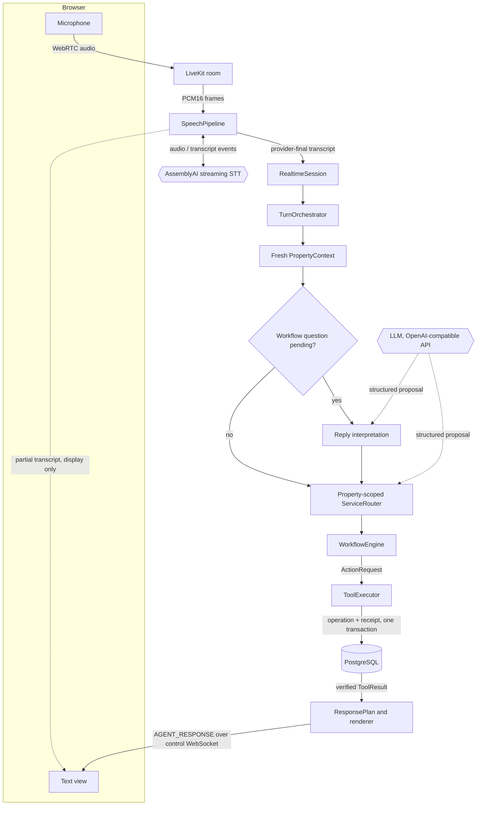

# Relay

Relay is real-time voice agent infrastructure: property-scoped routing, durable workflows,
transactional tools, streaming speech input, and realtime execution with explicit cancellation
and reliability semantics. Property management is the demonstration domain.

A voice agent that takes actions has to coordinate speech recognition, service routing,
multi-turn workflow state, side effects, retries, disconnects and provider failures. The usual
failure is letting the model become the source of business truth: a generated "your ticket is
created" with no committed record, a retried tool call that creates a second incident, or a
context-free fragment that moves an emergency into a routine queue. In Relay, models and media
providers propose or transport. Backend code decides state transitions, executes side effects
and reports only what PostgreSQL confirms.

## Architecture



Solid arrows are Relay-owned control flow; dotted arrows are untrusted or display-only inputs.

| Component | Owns | Cannot do |
| --- | --- | --- |
| LiveKit | Media transport for one bound caller track | Choose property, identity or turns |
| AssemblyAI | Transcription and end-of-turn detection | Create a turn; Relay admits finals only |
| LLM | Structured proposals: route, reply kind, approved phrasing index | Select IDs outside the supplied catalog, write state, call tools, author factual response text |
| ServiceRouter | Catalog validation, configured evidence, clarify/abstain | Execute anything or remember previous routes |
| WorkflowEngine | Required fields, confirmation, transitions, action policy | Execute actions |
| ToolExecutor | Side effects, idempotency, receipt verification | Act without a persisted, authorized ActionRequest |
| PostgreSQL | Sessions, workflow runs, turn checkpoints, receipts, operational records | — |

## Core design constraints

**Property context before routing.** Each turn reloads the caller's property and its enabled
services. The router sees only that catalog; a Palm Heights session cannot route to an Atlas
Residence service whatever the model returns. Service names are data, so a service added in the
database becomes routable without code changes.

**Routing is not execution.** Routing outputs ROUTED, CLARIFICATION_REQUIRED or ABSTAINED.
Unique configured phrases route without a model; other text goes to a strict structured-output
model call whose proposal is revalidated against the catalog. Clarification questions are
rendered by the backend from validated choices (ADR 007).

**An ActionRequest is not success.** Workflows declare actions; ToolExecutor executes them.
A success response requires a ToolResult whose operation and receipt were committed and then
re-read in a fresh transaction.

**Retries do not repeat unknown operations.** Actions carry a stable UUID and a canonical
request hash. An identical retry replays the recorded result; changed arguments conflict. If a
commit acknowledgment is lost and verification is unavailable, the outcome is UNKNOWN_OUTCOME
and nothing is re-executed until it is reconciled.

**Realtime state and business state are separate.** Connections, tasks and queues are
ephemeral and owned by RealtimeSession. Disconnect cancels and awaits in-flight work but does not
roll back committed operations; reconnect reloads durable state.

**Partial transcripts never create turns.** Partials are display events that may be dropped
under backpressure. Only provider-final text becomes an application turn, with an identity
derived from the provider stream and turn order so duplicate finals are suppressed.

**Pending workflow replies are interpreted with workflow context.** When a workflow is waiting
on a field, one model call classifies the reply as an answer, a new request or ambiguous, and
also reports how it would route the utterance on its own. Backend policy resolves conflicts.
Answers continue the active workflow without making routing sticky (ADR 008).

## Example execution path

The acceptance flow, spoken through a browser microphone at Atlas Residence:

| Caller | Relay |
| --- | --- |
| "My AC isn't cooling properly." | Configured evidence → Non-Emergency Maintenance; asks for symptoms |
| "My AC is only blowing warm air." | Answer → maintenance request proposed, awaiting confirmation |
| "Actually, water is spouting out of it." | Model route → Emergency Maintenance. The unexecuted routine proposal is superseded; asks for location |
| "Living room AC." | The model's routing view of this fragment is routine AC maintenance; its reply verdict is "answer". Policy pins it to the active emergency and stores it verbatim; asks about hazards |
| "No, nothing electrical." / "It's continuous." | Stored as hazard and severity → `CREATE_EMERGENCY_INCIDENT` |
| "Wait, the water is getting close through an electrical outlet." | `UPDATE_EMERGENCY_INCIDENT` on the same incident (revision 2) |
| "I want to speak with someone." / "Yes, please." | Human Handoff carrying the incident context → `CREATE_HUMAN_HANDOFF`, linked to the incident. The reply states that no live transfer occurred |

The "Living room AC." turn is the reason ADR 008 exists. Before it, a reply to a pending
question was routed without conversation context, and real speech downgraded an active
emergency to routine maintenance (no effects executed). Treating every reply as an answer would
fix that but would swallow a genuine new emergency ("someone is breaking in") as a location.
Relay pins an answer only when the conflicting route is a routine implemented workflow; a
conflict with a safety-critical, handoff or unsupported service is clarified, and an unfinished
emergency is never left automatically for a routine workflow.

## Reliability and safety semantics

- **Idempotency.** Action UUID plus canonical request hash, enforced by unique constraints. An
  incident update uses its own action identity, targets the existing incident, and does not
  increment the revision twice on retry.
- **Transaction boundaries.** The local operation row and its `tool_calls` receipt commit in
  one transaction, then are verified from a new transaction before success is reported. External
  systems cannot join that transaction; this is local atomicity, not distributed exactly-once.
- **Checkpoint before dispatch.** The orchestrator persists "dispatch started" before calling
  the executor. Recovery after that point verifies receipts and never re-dispatches.
- **Replay.** Turns carry a UUID, sequence number and expected revision. An exact replay returns
  the saved result, including the saved reply interpretation, without calling the model. A
  reused turn ID with different content conflicts.
- **Concurrency.** Compare-and-swap session revisions, a PostgreSQL per-session advisory lock
  around each turn, and one active turn per realtime session. A busy final is rejected, not
  queued.
- **Property isolation.** Composite foreign keys tie runs, turns and operations to one property.
  Model proposals naming foreign or invented IDs are rejected.
- **Safety-critical transitions.** Workflow capabilities declare `safety_critical`; an unfinished
  safety-critical run cannot be downgraded automatically. The caller must cancel first.
- **Provider contracts.** Model calls use strict JSON schema; refusals, truncation, tool calls,
  extra fields and timeouts become abstention or clarification. There are no automatic retries.
- **Truthful responses.** Responses are rendered from a typed ResponsePlan. Operational status
  clauses are deterministic templates; an optional model may only choose among approved
  phrasings for non-operational text. FAILED and UNKNOWN_OUTCOME are reported as such.

## Realtime speech pipeline

```text
Browser microphone → LiveKit → PCM16 mono 16 kHz frames → AssemblyAI v3 streaming WebSocket
  → partial transcripts: display only
  → provider end-of-turn final → RealtimeSession → TurnOrchestrator → text response
```

The browser receives a five-minute token that can publish only its microphone in a room derived
from the session ID; the backend token can subscribe but not publish. Audio sends are bounded
and await backpressure. Property vocabulary is passed to the STT provider as keyterms
(allowlisted names only, no resident data). STT failure closes the stream and asks the caller to
repeat; partials are never promoted to finals.

Responses are text. **TTS is not implemented. Barge-in is not implemented.**

## Verification

Measured on 2026-10-14:

- **Automated suite:** 310 passed, 0 failed, 0 skipped. Runs in Docker against real
  PostgreSQL 17 and a LiveKit server, with scripted model and STT doubles. Strict mypy, Ruff
  lint and format, and `alembic check` are clean.
- **Live browser test:** the nine-turn flow above, spoken through a real browser microphone →
  local LiveKit → AssemblyAI streaming → Relay with a hosted model (OpenRouter, strict structured
  output) → PostgreSQL. Natural replies, no prompt prefixes.
- **Database checks after that run:**
  - exactly one emergency incident, updated in place to revision 2;
  - exactly one handoff, linked to that incident;
  - three tool calls, each executed once;
  - no maintenance request from the superseded proposal;
  - no foreign-property IDs in any stored document.

A live routing evaluation was attempted but is not reported as a benchmark: provider rate
limiting rejected most model calls and invalidated the aggregate result. The offline evaluation
(146 cases, 10 property configurations) uses a deterministic lexical double. It measures
isolation and contract enforcement, not model accuracy. See
[routing benchmarks](docs/routing-benchmarks.md) and [verification records](docs/verification/README.md).

## Current limitations

- No TTS or barge-in. Responses are text only.
- One backend process owns realtime connections; there is no multi-worker ownership or durable
  event-offset resume.
- The demo session, turn and voice endpoints have no authentication. They are disabled in
  production mode, which is not a substitute.
- Reply interpretation and routing depend on model classification. Clean live accuracy numbers
  do not exist yet for either.
- The microphone is always on, so background speech becomes turns. In the acceptance run those
  turns abstained or had no effect, but they were not filtered.
- Operations (maintenance requests, incidents, tour requests, handoffs) are local PostgreSQL
  records. There is no real PMS, calendar, emergency dispatch or telephony integration, and a
  handoff is a recorded request, not a live transfer.
- Four workflow capabilities exist: emergency maintenance, non-emergency maintenance, leasing
  tour request and human handoff. Other services route correctly but are reported as unsupported.

## Repository layout

```text
backend/app/
  property/     PropertyContext resolution (ORM-free)
  routing/      property-scoped router, configured evidence, model contract validation
  agent/        TurnOrchestrator, reply interpretation, reconciliation, ResponsePlan, rendering
  workflows/    deterministic workflow engine, capability registry, transitions
  tools/        ToolExecutor, authorization, idempotency, receipts
  realtime/     RealtimeSession, WebSocket protocol, speech pipeline, LiveKit media source
  providers/    LLM and STT adapters behind neutral protocols (tts/ and embeddings/ are empty)
  db/           SQLAlchemy models, repositories, tool store, seeds
  api/, core/   HTTP endpoints, settings, lifecycle, logging
backend/migrations/   Alembic migrations (14 domain tables)
backend/tests/        unit, contract and PostgreSQL/LiveKit integration tests
evaluations/          routing dataset, offline evaluation, live STT check
frontend/voice.html   manual microphone test page
docs/                 design documents, ADRs, verification records
```

## Running locally

Requires Docker with Compose and [uv](https://docs.astral.sh/uv/) 0.12.24 or newer.

Full test suite (isolated PostgreSQL and LiveKit, nothing published to the host):

```text
docker compose -f compose.test.yml up --build --abort-on-container-exit --exit-code-from tests
docker compose -f compose.test.yml down
```

Development stack with seeded demo data:

```text
docker compose build backend
docker compose up -d --wait postgres
docker compose run --rm backend alembic upgrade head
docker compose run --rm backend relay-seed
docker compose up -d --wait backend
```

The backend listens on `http://127.0.0.1:8000` (`/health`, `/ready`). Text turns go through
`POST /api/demo/sessions` and `POST /api/sessions/{id}/turns`. Without a model configured, only
configured phrases route; set the `ROUTING_MODEL_*` variables from `.env.example` to enable the
model stage. The voice demo needs a LiveKit server and an AssemblyAI key; the procedure is in
[development](docs/development.md#voice-demo-local-livekit).

## Engineering docs

- [Architecture](docs/architecture.md): module boundaries, invariants, rejected patterns
- [Routing](docs/routing.md) and [routing benchmarks](docs/routing-benchmarks.md)
- [Orchestration](docs/orchestration.md): turn lifecycle, checkpoints, recovery, response planning
- [Workflows](docs/workflows.md) and [tools](docs/tools.md)
- [Realtime](docs/realtime.md) and [speech](docs/speech.md)
- [Contracts and terms](docs/contracts.md)
- Decisions: [001](docs/decisions/001-property-context-before-routing.md) context before routing,
  [002](docs/decisions/002-provider-abstractions.md) provider abstractions,
  [003](docs/decisions/003-tools-own-side-effects.md) tools own side effects,
  [004](docs/decisions/004-cancellable-presentation-state.md) cancellable presentation,
  [005](docs/decisions/005-property-specific-services.md) property-specific services,
  [006](docs/decisions/006-routing-cascade.md) routing cascade,
  [007](docs/decisions/007-constrained-clarification.md) backend-rendered clarification,
  [008](docs/decisions/008-pending-reply-interpretation.md) pending-reply interpretation
- [Verification records](docs/verification/README.md)
- [Development](docs/development.md)

## Roadmap

- Streaming TTS through a LiveKit agent output track
- Barge-in with presentation cancellation that preserves committed operations
- Latency and accuracy measurement: routing, reply interpretation, end-to-end response time
- Deployment hardening: authentication, multi-worker realtime ownership, input admission policy

Constraints for this work are in [roadmap](docs/roadmap.md).
